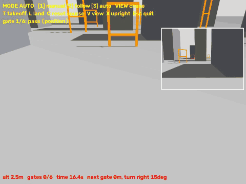
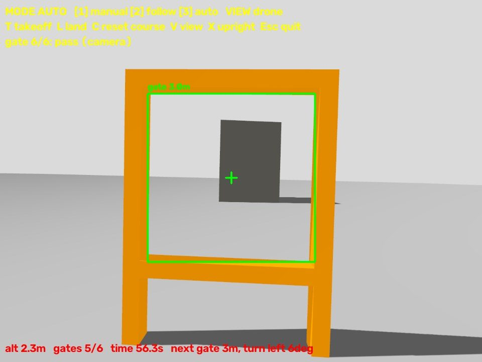
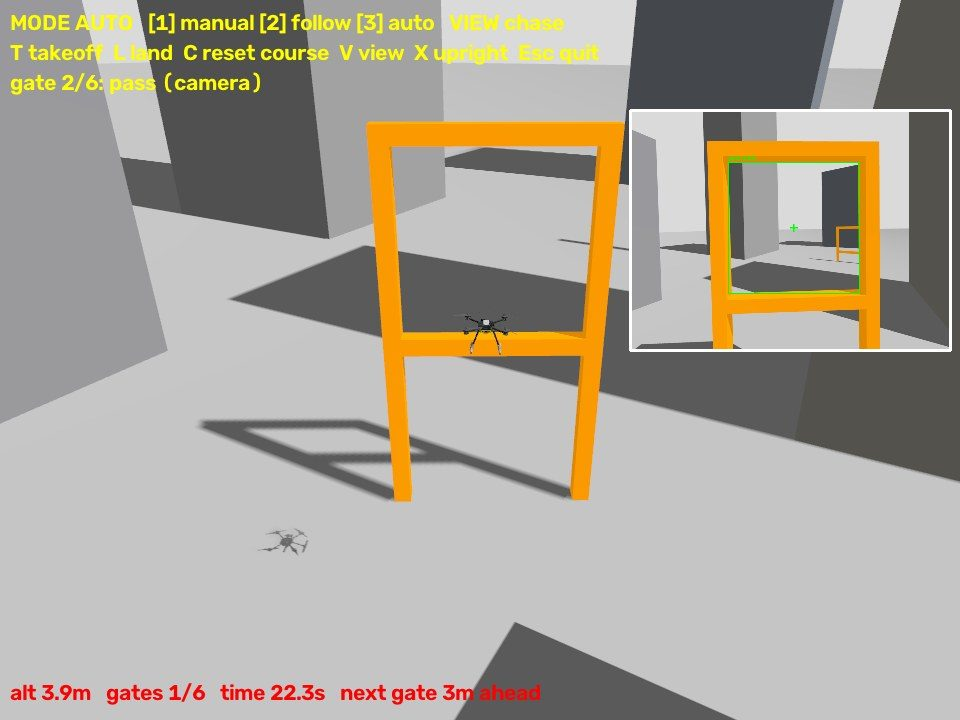
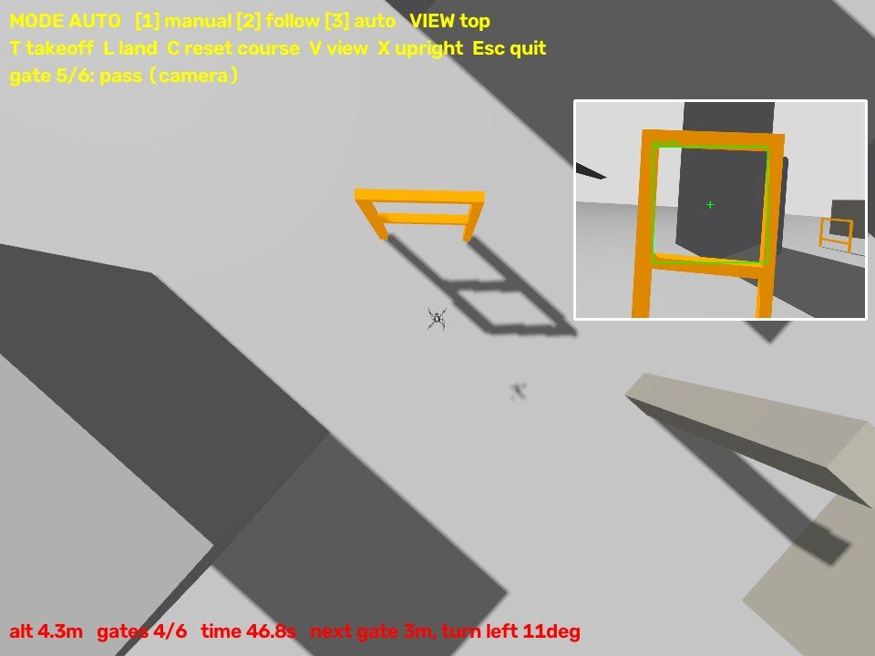

# 🚁 AI 드론 시뮬레이터

돈 들이지 않고 시뮬레이터 안에서 **카메라로 사람을 인식해 따라가고, 도시 장애물 코스를 스스로 통과하는 드론**을 만든 프로젝트입니다.
실제 드론에 들어가는 비행 제어 펌웨어(PX4)를 그대로 쓰기 때문에, 나중에 실제 기체로 옮겨도 Python 코드를 거의 그대로 쓸 수 있습니다.

> 환경: MacBook (Apple Silicon), macOS · PX4 SITL · Gazebo 8 · MAVSDK 4 · YOLO (Ultralytics)

<p align="center">
  
  <br><sub>코스 자동 통과 (추격 시점). 오른쪽 위 작은 화면은 드론 카메라이고, 초록 박스가 카메라로 찾은 게이트 구멍입니다.</sub>
</p>

| 드론 카메라: 게이트 인식 | 추격 시점 | 위에서 보기 |
|:---:|:---:|:---:|
|  |  |  |

`drone --auto`로 실제로 돌려서 찍은 화면입니다. 이 실행에서는 게이트 6개를 60.3초에 완주했습니다.

---

## ✨ 주요 기능

| 모드 | 설명 |
|------|------|
| **1. 직접 조종** | 키보드로 조종합니다. 두 키를 같이 누르면 대각선으로 가고, 속도가 부드럽게 바뀝니다. |
| **2. 사람 따라가기** | YOLO로 사람을 찾아 화면 가운데에 두고 약 4m 거리를 유지하며 따라갑니다. |
| **3. 코스 자동 통과** | 도시 맵의 주황색 게이트 6개를 카메라로 찾아 차례로 통과한 뒤 출발점으로 돌아옵니다. |

모든 모드에 공통으로 들어간 안전장치:
- **충돌 방지**: 건물, 게이트, 사람과의 거리에 맞춰 속도를 줄이고, 표면 1m 앞에서 멈춥니다.
- **착륙 자리 고르기**: 지붕 가장자리나 기둥 꼭대기처럼 위험한 곳이면 가까운 평평한 곳으로 옮겨서 내립니다.
- **전복 처리**: 60도 넘게 기울면 모터를 끕니다. `X` 키로 그 자리에 다시 세울 수 있습니다.
- **추격 시점, 위에서 보기**: 드론 카메라 말고도 화면 시점 3가지를 고를 수 있습니다.

---

## 📊 결과

| 단계 | 결과 |
|------|------|
| Python으로 이륙, 착륙, 사각형 비행 | ✅ 성공 |
| 웹캠, 드론 카메라에서 YOLO로 사람 인식 | ✅ 6m 앞 사람 신뢰도 0.80 |
| 가만히 있는 사람 따라가기 | ✅ 6m → 4m까지 다가가 정지, 좌우 오차 0.03 이내 |
| 움직이는 사람 따라가기 | ✅ 0.6 m/s로 걷는 사람을 60초 동안 놓치지 않음 |
| 게이트 6개 자동 통과 | ✅ 39.3초 완주. 충돌 방지를 넣은 뒤에는 3번 연속 49.9초 |
| 벽 충돌 방지 | ✅ 벽 쪽으로 계속 밀어도 벽 표면 0.79m 앞에서 멈춤 |
| 조종 반응 속도 | ✅ 한 바퀴 처리 시간 60ms → 33ms (1초에 30번으로 고정) |

---

## 🧩 구조

```
[Gazebo 시뮬레이터]  가상 도시 + 가상 드론 + 가상 카메라
        │  카메라 영상
        ▼
[Python 코드]  YOLO로 사람 인식 / 색으로 게이트 인식 → 이동 방향 판단
        │  MAVLink 명령 (MAVSDK)
        ▼
[PX4 SITL]  실제 드론용 비행 제어 펌웨어를 Mac에서 실행
        │
        ▼
[Gazebo 속 드론이 움직임]
```

- **PX4**: 실제 드론에 쓰이는 오픈소스 비행 제어 펌웨어
- **SITL**: PX4를 드론 대신 내 컴퓨터에서 실행하는 방식
- **Gazebo**: 물리 법칙과 카메라 센서까지 흉내 내는 3D 시뮬레이터
- **MAVSDK**: Python에서 PX4로 이륙, 이동, 착륙 명령을 보내는 라이브러리
- **YOLO**: 영상에서 사람을 찾는 AI 모델 (`yolo26n.pt`, 가장 작고 빠른 모델)

---

## 🚀 설치

> ⚠️ 프로젝트 폴더는 반드시 **`~/drone`처럼 영문 경로이면서 바탕화면, 문서 폴더 밖**에 둡니다.
> 경로에 한글이 있으면 Gazebo 창이 바로 꺼집니다. 바탕화면은 iCloud와 동기화되어 시뮬레이터가 켜지지 않을 수 있습니다.

```bash
# 1. 이 저장소 받기
git clone https://github.com/yeoyunu3-cloud/drone.git ~/drone
cd ~/drone

# 2. PX4 받기 (용량이 커서 이 저장소에는 넣지 않았습니다)
git clone https://github.com/PX4/PX4-Autopilot.git
cd PX4-Autopilot
git submodule update --init --recursive --force
./Tools/setup/macos.sh --sim-tools     # Gazebo까지 설치
brew install pkgconf                   # 빠지면 빌드가 멈춥니다
echo "ulimit -S -n 2048" >> ~/.zshrc   # 열 수 있는 파일 개수 늘리기

# 3. 내 코드용 가상환경 (Gazebo Python 모듈을 쓰려면 PX4의 Python 3.13으로 만들어야 합니다)
~/drone/PX4-Autopilot/Tools/setup/macos/.pixi/envs/default/bin/python3 -m venv --system-site-packages ~/drone/venv
source ~/drone/venv/bin/activate
pip install -r ~/drone/requirements.txt
pip install --ignore-installed "numpy<2.5"   # PyTorch와 OpenMP 충돌 방지

# 4. drone 명령 등록 (등록 후 터미널을 새로 엽니다)
echo 'alias drone="$HOME/drone/drone"' >> ~/.zshrc
```

---

## 🎮 실행

```bash
drone
```

명령 하나로 도시 맵 시뮬레이터와 조종 창이 함께 켜집니다. 시뮬레이터가 켜지는 데 1분쯤 걸리고, 조종 창을 닫으면 시뮬레이터도 같이 꺼집니다.

| 옵션 | 설명 |
|------|------|
| `drone --no-sim` | 이미 켜 둔 시뮬레이터에 붙습니다 |
| `drone --auto` | 켜자마자 코스 자동 통과를 시작합니다 |
| `drone --auto --headless` | 창 없이 코스를 돌고 끝냅니다 (테스트용) |
| `drone --duration 60` | 60초 뒤 착륙하고 끝냅니다 |

### 조종 키

| 키 | 동작 |
|----|------|
| `1` / `2` / `3` | 직접 조종 / 사람 따라가기 / 코스 자동 통과 |
| `T` / `L` / `Esc` | 이륙 / 착륙 / 착륙 후 종료 |
| `W` `S` / `A` `D` | 앞뒤 / 좌우 |
| `↑` `↓` / `←` `→` | 위아래 / 회전 (`R` `F`, `Q` `E`도 됩니다) |
| `Space` | 바로 멈춤 |
| `V` | 시점 바꾸기: 드론 카메라 → 추격 시점 → 위에서 보기 |
| `C` | 코스 기록 초기화 |
| `X` | 넘어진 드론을 똑바로 세우기 |

---

## 🧠 동작 원리

### 사람 따라가기 (비례 제어)
1. YOLO가 찾은 가장 큰 사람 박스에서 **좌우 오차**(`error_x`, -1~+1)와 **박스 높이 비율**을 구합니다.
2. 회전 속도 = `40 × error_x` (최대 30°/s). 사람이 오른쪽에 있으면 오른쪽으로 돕니다.
3. 전진 속도 = `6 × (0.24 - 박스 높이)`. 0.24는 약 4m 거리입니다. 사람이 다가오면 드론이 뒤로 물러납니다.
4. 오차가 아주 작으면 무시해서 제자리에서 떨지 않게 합니다. 사람을 놓치면 멈춥니다.

### 게이트 자동 통과
1. 게이트 4m 앞까지 좌표로 날아가서 게이트를 정면으로 봅니다.
2. 1.5 m/s로 나아가면서 카메라로 **주황색 틀 속 구멍**을 찾고, 가운데에서 벗어난 만큼 보정합니다.
3. 구멍의 픽셀 크기와 실제 크기(2.5m)를 비교해 거리를 계산합니다.
4. 통과한 뒤에는 1.5m 곧장 빠져나간 다음 꺾습니다. 바로 꺾으면 틀에 걸립니다.
5. 다음 게이트로 가는 길에 건물이 있으면 그 꼭대기보다 2m 높이 올라가서 넘어갑니다.

### 맵
`course.py`에 건물 9채, 기둥 2개, 게이트 6개, 사람 1명의 위치가 적혀 있고, 이 파일이 맵의 유일한 원본입니다.
`make_world.py`가 이 파일을 읽어 Gazebo 맵(`worlds/city.sdf`)을 만듭니다. 맵을 만들기 전에 자동 비행 경로가 건물에서 1.5m 이상 떨어져 있는지 테스트로 검사합니다.

---

## 📁 파일 구조

```
drone/
├── drone                  # `drone` 명령의 실행 스크립트
├── run_sim.sh             # 시뮬레이터만 따로 켜기
├── requirements.txt
├── worlds/city.sdf        # 도시 맵 (make_world.py가 만듦)
├── 드론_프로젝트_계획.md   # 단계별 개발 기록 (자세한 버전)
└── code/
    ├── app.py             # ⭐ 통합 프로그램 (창, 키, 모드 전환)
    ├── modes.py           # 직접 조종 / 따라가기 / 자동 통과
    ├── drone_link.py      # PX4 연결, 이륙, 착륙, 명령
    ├── course.py          # 맵 원본 + 게이트 통과 판정
    ├── make_world.py      # course.py → city.sdf
    ├── gate_vision.py     # 색으로 게이트 찾기
    ├── vision.py          # YOLO로 사람 찾기
    ├── safety.py          # 충돌 방지
    ├── landing.py         # 착륙, 세우기 자리 고르기
    ├── view_camera.py     # 추격 시점, 위에서 보기
    ├── held_keys.py       # 지금 눌린 키 읽기 (macOS)
    ├── drone_camera.py    # Gazebo 카메라 영상 받기
    ├── follow_person.py   # 사람 따라가기 (단독 실행용)
    ├── move_person.py     # 시뮬레이터 속 사람을 걷게 하기 (테스트용)
    ├── keyboard_control.py
    ├── takeoff_land.py    # 첫 Python 비행
    ├── square_flight.py   # 사각형 비행
    ├── yolo_webcam.py     # 웹캠으로 YOLO 테스트
    └── test_*.py          # 단위 테스트
```

테스트 실행:

```bash
cd ~/drone/code && source ../venv/bin/activate
python -m unittest test_course.py test_safety.py
python test_modes.py && python test_landing.py
```

---

## 🛠️ 개발 과정

| 단계 | 내용 |
|------|------|
| Phase 0 | PX4, Gazebo 설치 |
| Phase 1 | 코드 없이 시뮬레이터에서 첫 비행 |
| Phase 2 | Python(MAVSDK)으로 이륙, 착륙, 사각형 비행 |
| Phase 3 | Mac 웹캠으로 YOLO 사람 인식 |
| Phase 4 | 카메라 달린 드론 영상에 YOLO 적용 |
| Phase 5 | 사람 따라가기 (최종 목표) |
| Phase 7 | 통합 프로그램 + 도시 장애물 코스 + 안전장치 |
| Phase 6 | (예정) 실제 기체로 옮기기: Tello 또는 Pixhawk 기체 |

단계별 자세한 기록은 [`드론_프로젝트_계획.md`](./드론_프로젝트_계획.md)에 있습니다.

---

## ❗ 막혔던 문제와 해결

| 증상 | 원인과 해결 |
|------|-------------|
| Gazebo 창이 뜨자마자 꺼짐 (`Abort trap: 6`) | 경로에 한글이 있어서 생깁니다. `~/drone`처럼 영문 경로로 옮깁니다. |
| 시뮬레이터가 몇 분째 안 켜짐 | 폴더가 iCloud(바탕화면)에 있어서 생깁니다. 밖으로 옮깁니다. |
| `Waiting for Gazebo world...`만 계속 나옴 | `GZ_IP=127.0.0.1`이 빠진 것입니다. `run_sim.sh`로 실행합니다. |
| `System is not constructed directly` | MAVSDK v4에서 사용법이 바뀌었습니다. `Mavsdk(config)`와 `first_autopilot()`을 씁니다. |
| `OMP: Error #15` | numpy와 PyTorch가 충돌합니다. venv에 pip numpy를 따로 설치합니다. |
| 빌드 중 `Could NOT find PkgConfig` | `brew install pkgconf` |
| 다시 켜면 시뮬레이터가 이상함 | 남은 Gazebo를 끕니다: `pkill -9 -f "gz sim"` |
